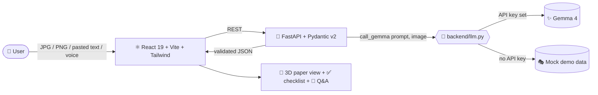

<div align="center">



<br/>

### 📋🛡️ Plain-language, evidence-backed action checklists for official notices, college circulars, scholarships & public instructions — in **English** and **हिन्दी**

<br/>


<br/>

<a href="https://notice-guard-ai.vercel.app/">
  
</a>

<sub>Hosted on Vercel · Try it now, no sign-up needed</sub>

**[🌐 Live Demo](https://notice-guard-ai.vercel.app/)** •
**[🚀 Quickstart](#-quickstart-run-the-prototype-in-5-minutes)** •
**[✨ Features](#-features)** •
**[🔑 API Key](#-plug-in-your-gemma-4-api-key)** •
**[🧪 Tests](#-acceptance-tests)** •
**[🛠️ Troubleshooting](#-troubleshooting)** •
**[🤝 Contributing](#-contributing)**

</div>


## 🌐 Live Demo

> 👉 **[https://notice-guard-ai.vercel.app/](https://notice-guard-ai.vercel.app/)**

Open the link, pick a **sample notice** (or paste text / upload a JPG or PNG), then try the checklist, **English ⇄ हिन्दी** toggle, **"See in notice"** highlighting, Q&A and voice.


## 💡 What is NoticeGuard AI?

Official notices are long, jargon-heavy and easy to misread — and a missed deadline can cost a scholarship, an admission or a benefit.

**NoticeGuard AI** turns any confusing notice into a **clear, verifiable checklist**. It never guesses: every item is tied back to the exact text in the notice, and anything missing is clearly labelled.

> 🧠 **Golden rule:** *If the notice doesn't say it, NoticeGuard doesn't either.*


## ✨ Features

| | Feature | What it does |
|:-:|---|---|
| 🚫 | **No Hallucinations** | Missing details always show **"Not stated in this notice"**. Nothing is invented. |
| ⚠️ | **Uncertainty Guard** | Blurry or ambiguous items ask the user to confirm before being trusted. |
| ⚔️ | **Conflict Detection** | Conflicting deadlines/requirements appear **side-by-side** with a **"Use this one"** button. |
| 🌐 | **English ⇄ हिन्दी** | Instant language toggle — dates, amounts, names and conditions never drift. |
| 🔍 | **"See in notice"** | Click any checklist item to highlight its source text in the 3D paper view (`#FFD93D` highlighter). |
| 📅 | **Calendar export** | One-click `.ics` download when a deadline exists (disabled with a tooltip when it doesn't). |
| 💬 | **Strictly-grounded Q&A** | Ask questions; unanswerable ones get *"The notice doesn't say this."* |
| 🎙️ | **Voice in & out** | Speak in Hindi or English, hear the answer in the same language. |
| 🧭 | **Guided Mode** | "Guide me" reads the checklist step by step and listens for *Next / Repeat / Done*. |
| ♿ | **Accessible** | WCAG AA contrast, 3px highlighter focus rings, full keyboard navigation. |
| 🔒 | **Zero disk persistence** | Sessions live only in memory. Nothing is saved to disk. |
| 🎭 | **Demo / Mock mode** | Works out of the box with realistic sample notices — **no API key needed**. |


## 🏗️ Architecture



**Stack at a glance**

- **Frontend:** React 19 · Vite · Tailwind CSS
- **3D visuals:** pure CSS 3D transforms (`perspective: 1400px`, `transform-style: preserve-3d`) + pointer parallax — **no WebGL**, smooth on mobile
- **Backend:** Python FastAPI · Pydantic v2 validation
- **AI engine:** Gemma 4 through a **single entrypoint** `call_gemma(prompt, image=None)` in `backend/llm.py`
- **Voice:** Web SpeechRecognition + SpeechSynthesis with graceful fallbacks


## 📁 Project Structure

```text
noticeguard-ai/
├── assets/                # README banner & divider graphics
├── backend/
│   ├── main.py            # FastAPI app (run with uvicorn)
│   ├── llm.py             # call_gemma(prompt, image=None) – single AI entrypoint
│   └── requirements.txt   # Python dependencies
├── frontend/              # React 19 + Vite + Tailwind app
│   └── package.json
├── .env.example           # Environment variable template
├── .gitignore
├── LICENSE
└── README.md
```


## 🚀 Quickstart: Run the Prototype in 5 Minutes

### ✅ Step 0 — Prerequisites

| Tool | Version | Check with |
|---|---|---|
| 🐍 Python | 3.10+ (tested on 3.13) | `python --version` |
| 🟢 Node.js | 18+ (tested on v24) | `node --version` |
| 📦 npm | 9+ | `npm --version` |
| 🌿 Git | any recent | `git --version` |

### 📥 Step 1 — Clone the repository

```bash
git clone https://github.com/YOUR_USERNAME/noticeguard-ai.git
cd noticeguard-ai
```

### 🐍 Step 2 — Start the Backend

<details open>
<summary><b>🍎 macOS / 🐧 Linux</b></summary>

```bash
cd backend
python3 -m venv .venv
source .venv/bin/activate
pip install -r requirements.txt
cp ../.env.example .env          # optional – skip to use Demo mode
uvicorn main:app --host 0.0.0.0 --port 8000 --reload
```
</details>

<details>
<summary><b>🪟 Windows (PowerShell)</b></summary>

```powershell
cd backend
python -m venv .venv
.venv\Scripts\Activate.ps1
pip install -r requirements.txt
copy ..\.env.example .env        # optional – skip to use Demo mode
uvicorn main:app --host 0.0.0.0 --port 8000 --reload
```
</details>

✅ Backend is live at **http://localhost:8000** — interactive API docs at **http://localhost:8000/docs**

### ⚛️ Step 3 — Start the Frontend

Open a **new terminal** and run:

```bash
cd frontend
npm install
npm run dev
```

✅ Open **http://localhost:5173** in your browser (Chrome or Edge recommended for voice).

### 🎉 Step 4 — Try it!

1. Look for the **"Demo data"** badge in the header — you're in Mock Mode (no key required).
2. Pick a **sample notice** or paste notice text / upload a **JPG or PNG**.
3. Review the checklist, click **"See in notice"**, toggle **English ⇄ हिन्दी**.
4. Ask a question by typing or tapping the 🎙️ mic.
5. Try **"Guide me"** and say *Next*, *Repeat* or *Done*.

### 🏭 Step 5 *(optional)* — Production build

```bash
cd frontend
npm run build        # outputs to frontend/dist
npm run preview      # preview the production build locally
```


## 🔑 Plug in your Gemma 4 API Key

All AI calls go through **one function**: `call_gemma(prompt, image=None)` in [`backend/llm.py`](backend/llm.py).

1. Copy the template: `cp .env.example backend/.env`
2. Edit `backend/.env`:

```ini
GEMMA_PROVIDER=openai-compatible
GEMMA_API_KEY=your_gemma_api_key_here
GEMMA_MODEL=gemma-4
GEMMA_BASE_URL=https://api.together.xyz/v1   # or your Groq / Ollama / Google endpoint
DEBUG=false
```

3. Restart the backend.

| Variable | Purpose |
|---|---|
| `GEMMA_PROVIDER` | API style (`openai-compatible`) |
| `GEMMA_API_KEY` | Your secret key — **leave blank for Demo/Mock mode** |
| `GEMMA_MODEL` | Model name (default `gemma-4`) |
| `GEMMA_BASE_URL` | Provider endpoint (Together, Groq, Ollama, Google…) |
| `DEBUG` | Verbose logs when `true` |

> 🔐 **Never commit your `.env` file.** It is already listed in `.gitignore`.


## 🧪 Acceptance Tests

| # | Scenario | ✅ Verified behavior |
|:-:|---|---|
| 1 | **Notice with deadline** | Deadline shown with **"See in notice"** highlighting the source in the 3D paper view; `.ics` download enabled. |
| 2 | **Notice with no deadline** | Shows **"Not stated in this notice"**. No date invented. `.ics` disabled with a helpful tooltip. |
| 3 | **Conflicting dates** | Both snippets side-by-side with **"Use this one"**. Choice is logged under **"Your confirmations"**. |
| 4 | **Language toggle** | English ⇄ Hindi switch keeps every date, number, amount and name identical. |
| 5 | **Strict Q&A grounding** | *"Is there an application fee?"* on a notice without one → *"The notice doesn't say this."* |
| 6 | **Voice in & out** | Hindi question → Hindi answer. English question → English answer. |
| 7 | **Invalid files / input** | `.pdf` or empty text → *"Only JPG, PNG or pasted text work. Your file was a .pdf."* |
| 8 | **Guided mode** | "Guide me" reads steps aloud and listens for *Next*, *Repeat*, *Done*. |


## ☁️ Deployment

| Part | Host | Notes |
|---|---|---|
| ⚛️ Frontend | **Vercel** → [notice-guard-ai.vercel.app](https://notice-guard-ai.vercel.app/) | Root directory: `frontend`, framework: Vite |
| 🐍 Backend | Render / Railway (or any Python host) | Root: `backend` · Start: `uvicorn main:app --host 0.0.0.0 --port $PORT` |

Set your backend URL as an environment variable on Vercel, and allow your Vercel domain in the backend's CORS settings.


## 🛠️ Troubleshooting

| Problem | Fix |
|---|---|
| `uvicorn: command not found` | Activate your virtualenv, then re-run `pip install -r requirements.txt`. |
| Port **8000** or **5173** already in use | Use another port: `uvicorn main:app --port 8001` / `npm run dev -- --port 5174`. |
| Frontend can't reach backend | Make sure the backend is running on port 8000 and no firewall/VPN blocks `localhost`. |
| Header shows **"Demo data"** badge | `GEMMA_API_KEY` is empty. Add a key to `backend/.env` and restart the backend. |
| Mic button missing | Your browser lacks SpeechRecognition. Use **Chrome / Edge** — text input still works. |
| No Hindi voice reading answers | Install a `hi-IN` voice in your OS settings. Text stays visible meanwhile. |
| `.pdf` upload rejected | By design. Convert pages to **JPG/PNG** or paste the text. |
| `npm install` errors | Confirm Node 18+; delete `node_modules` & `package-lock.json`, then retry. |


## ⚠️ Known Limitations

1. **Browser speech support** — SpeechRecognition depends on the browser engine (Chrome/Edge). On unsupported browsers the mic hides gracefully and text input remains fully functional.
2. **Device TTS voices** — Hindi speech needs a device voice supporting `hi-IN`. Without one, a non-intrusive alert appears and the text stays visible.
3. **Multi-page PDFs** — This version accepts JPG, PNG and pasted text only. Convert PDF pages to images before uploading.

## 🗺️ Roadmap

- [ ] Native PDF & multi-page support
- [ ] More Indian languages (Marathi, Bengali, Tamil, Telugu…)
- [ ] Reminder notifications for deadlines
- [ ] Shareable / printable checklist
- [ ] Docker one-command setup


## 🤝 Contributing

Contributions are welcome!

```bash
git checkout -b feature/amazing-idea
git commit -m "feat: add amazing idea"
git push origin feature/amazing-idea
```

Then open a **Pull Request**. Please keep the core promise intact: **never invent information that isn't in the notice.**

## 📄 License

Distributed under the **[MIT License](LICENSE)**.

<div align="center">


**Made with 💜 to help people never miss what matters.**

⭐ *If this project helps you, please star the repo!* ⭐

</div>
